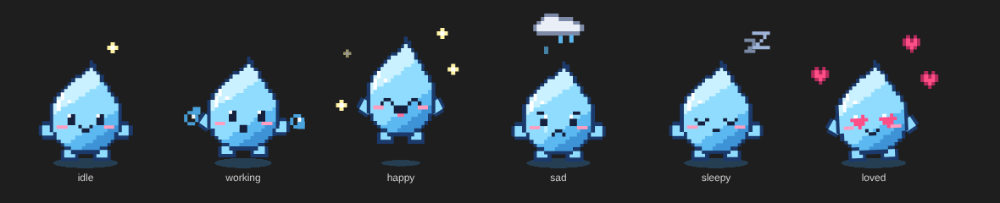

# Plip 💧

Plip is a tiny pixel-art water droplet that sits in the corner of Claude Code
and reacts to what Claude is doing. It bobs while Claude waits, splashes about
while Claude works, cheers when a task is done, and loves being petted.



## Install

Install Plip in **one** of these ways. No GitHub account is needed.

**From a Claude Code terminal session**, at the prompt:

```
/plugin install plip-pet --marketplace omprabhu31/plip-pet
```

Answer `y` to "Add marketplace?", then press Enter to pick the **user** scope
(so Plip appears in every session). You should see
`Installed plip-pet. Plugin is now active.`

**From a shell:**

```bash
claude plugin install plip-pet --marketplace omprabhu31/plip-pet
```

**From the Claude desktop app** (where `/plugin` isn't available): click **+**
next to the prompt box, then **Plugins**, **Add marketplace**, enter
`omprabhu31/plip-pet`, then **Add plugin** next to plip-pet.

A plugin installed from the terminal at the user scope also loads in the
desktop app's local Code sessions.

## Where Plip shows up

| App | What you see |
| --- | --- |
| Claude desktop app | A small animated widget in the bottom-right corner of the chat. Expand it for the full pane with a **Pet Plip** button and stats. |
| Terminal | The same animated pixel-art Plip, drawn with half-block characters, in a pane docked beside the chat in fullscreen or above the prompt otherwise. On a narrow terminal it waits until you type `/plip`; in a pane under 40 columns wide it falls back to a small text Plip. |
| VS Code, mobile | A pane with the animated Plip. |
| macOS desktop | With the overlay installed (see below), Plip floats over all your windows and starts at login. |

Plip opens by itself at the start of every session.

## Plip on your desktop (macOS)

Plip can also float above all your windows, outside the Claude app, and start
by itself when you log in. Get a copy of this repository and run its
installer:

```bash
git clone https://github.com/omprabhu31/plip-pet.git ~/plip-pet
```

```bash
~/plip-pet/overlay/install.sh
```

This builds **Plip Overlay** (it needs `swiftc`, from the Xcode command line
tools), puts it in `~/Applications`, and adds a login item, so Plip comes up
with your Mac just like the Claude desktop app does. macOS may show a
"background item added" notice the first time; that is the login item.

- **Drag** Plip anywhere. It stays there, on every Space and over full-screen apps.
- **Click** to open the Claude app: it comes to the front, or starts if it's closed.
- **Option-click** to pet it. Pets count toward the same total as the pane's button.
- **Hover** over Plip to pet it: heart eyes while the pointer is on it, back to normal the moment it leaves. Each visit counts as one pet; move away for a few seconds to pet it again.
- **Play something in Apple Music** and Plip dances, switching at random every 10 to 15 seconds between ten dances: the groove, a twirl under sweeping spotlights, confetti jumps, the robot, head-banging with lightning, a moonwalk through fog, a breakdance windmill, a party with two tiny droplet friends, a jelly wobble, and rainbow mode. It stops when the music pauses, stops or Music quits. Only Apple Music counts, and if music was already playing when Plip started, it joins in at the next play, pause or track change.
- **Right-click** to open Claude, pet, turn dancing to Apple Music on or off, change its size (Tiny, Small, Medium, Large; Medium, 100 points wide, is the default), move it back to the corner, or quit until your next login.

While the overlay is installed, the desktop app no longer opens its corner
widget (terminal sessions keep their pane, and `/plip` still opens the pane
anywhere). With several sessions open, the overlay shows one Plip for all of
them: a fresh reaction first, then any session at work. When no session is
running, Plip dozes until Claude is back.

The plugin and the overlay talk through files in `~/.plip`. If you update the
overlay's code, run `./overlay/install.sh` again. To remove it:

```bash
./overlay/uninstall.sh
```

## Usage

- **`/plip`**: brings Plip back if you closed it.
- **Pet Plip**: press the button (or `p` while the pane has focus) for heart
  eyes and floating hearts. Your pet count is saved across sessions.
- **Moods**: Plip changes mood on its own.

| Mood | When |
| --- | --- |
| Idle | Claude is waiting: Plip bobs, blinks and sparkles |
| Working | Claude is on a task: arms waving, bubbles rising, tool calls counted |
| Happy | A task finished: `^ ^` eyes, bouncing, sparkles |
| Sad | A tool call failed or a task errored: a little rain cloud |
| Sleepy | Nothing has happened for 5 minutes: `z`s drift up |
| Loved | You petted it: heart eyes and hearts |
| Vibing | Apple Music is playing (desktop overlay only): shades on, switching between ten disco dances |

The pane also shows how many tasks Plip has seen finish ("splashes") and how
many times you've petted it.

## Troubleshooting

- **No Plip at all**: run `/plip`. Then run `/plugin` and check that
  `plip-pet` is listed and enabled.
- **Still nothing**: ask Claude to run Plip's status tool
  (`mcp__plip-pet__status`). It reports whether your app is attached and
  whether the pane was placed. `no-surface` means the app showing the session
  doesn't draw mods: some cloud sessions viewed on the web are like this.
- **The overlay shows a plain 💧 or just dozes**: start a Claude session.
  The plugin writes Plip's art and mood to `~/.plip` when a session starts.
  Plip's status tool reports the overlay bridge under `overlay`.
- **Install fails to fetch the repository**: check that `git` is installed
  (on a Mac, `xcode-select --install` adds it) and that you can reach
  github.com.

## Update or remove

To update from a folder install, replace the folder's files with the new
version, then uninstall and install again:

```
/plugin uninstall plip-pet
```

```
/plugin install plip-pet --marketplace ~/plip-pet
```

(For a GitHub install, use `omprabhu31/plip-pet` in place of the folder.)
Start a new session afterwards so Plip opens with the new version.

To remove Plip, run only the uninstall line.

## Files

- `hooks/register.tsx`: Plip's behaviour (moods, the pane, `/plip`, petting)
- `hooks/overlay.ts`: writes Plip's mood to `~/.plip` for the desktop overlay
- `overlay/PlipOverlay.swift`: the macOS overlay app; `overlay/install.sh` and `overlay/uninstall.sh` add and remove it
- `hooks/sprite.ts`: the pixel art and animations: SVG for the apps, half-block cells for the terminal
- `types/index.d.ts`: the shape of the values Plip keeps
- `tests/plip.test.tsx`: run with `claude plugin test .`

MIT licensed.
